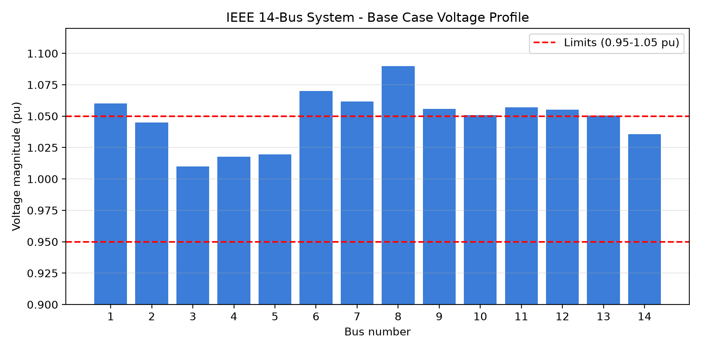
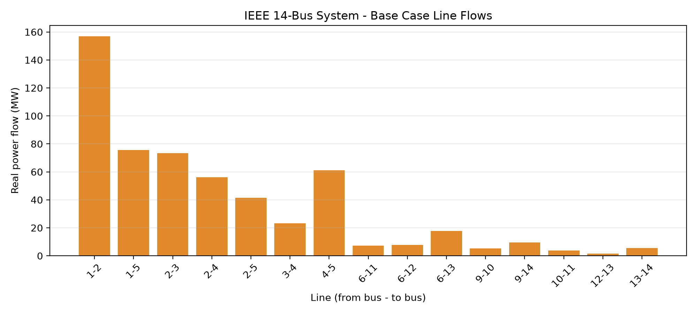
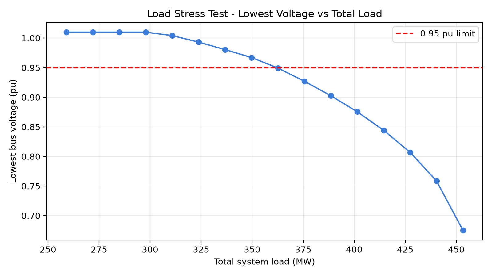
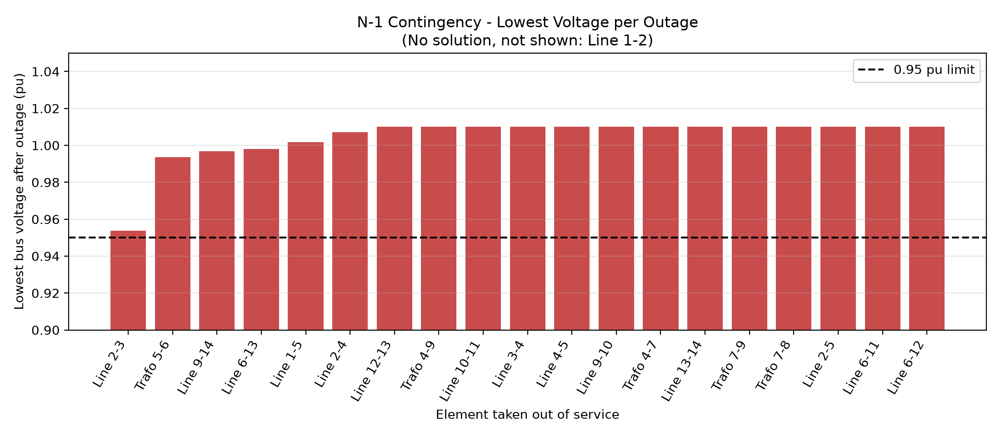
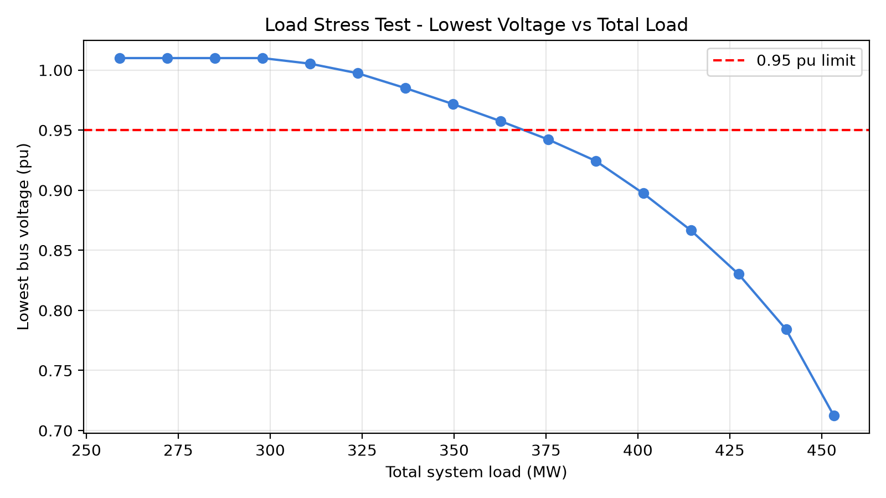

# IEEE 14-Bus Power Flow Study

I built this project to learn how engineers check if a power grid is healthy. I used the IEEE 14-bus
test system, a small standard grid used in a lot of power systems courses, and solved it in Python
with pandapower. Then I pushed it harder, broke parts of it, and tried a fix of my own.



## What I wanted to find out

1. Is the grid healthy on a normal day?
2. How much more load can it take before voltages get too low?
3. What happens if one line or transformer goes out?
4. Can a capacitor help the weakest bus? (my own addition)

## Main Results

| Question | Answer |
|---|---|
| Losses on a normal day | 13.39 MW, which is 4.92% of the 272.39 MW generated |
| Lowest voltage on a normal day | 1.010 pu at bus 3 (a generator bus). Lowest load-only bus is bus 4 at 1.018 pu |
| Voltage first drops below 0.95 pu at | 1.40x normal load, at bus 14 |
| Grid collapses at | 1.80x normal load |
| Worst single outage | Line 1-2. The load flow has no solution without it |
| My capacitor fix | 5 MVAr at bus 14 moves the 0.95 pu limit from 1.40x to 1.45x load |

## How it works

- **Input:** the IEEE 14-bus data that comes built into pandapower: 14 buses, 11 loads (259 MW total),
  5 generators, 15 lines, 5 transformers and 1 capacitor. `src/explore_data.py` prints all of it.
- **Solver:** `pp.runpp()` solves the load flow with Newton-Raphson. Load buses have known P and Q,
  generator buses have known P and voltage, and the slack bus (bus 1) covers whatever is left, including losses.
- **Output:** voltage and angle at every bus, power flow and losses on every line.
- `src/load_flow.py` runs four studies on this and saves the tables and plots in `results/`.

## 1. Normal Day (Base Case)

The generators make 272.39 MW and customers get 259.00 MW. The missing 13.39 MW is lost as heat
in the lines (I²R).

Every bus is above 0.95 pu, so nothing is too low. On the high side, 9 buses are slightly above 1.05 pu,
mostly because the generators at buses 6 and 8 are set to hold 1.07 and 1.09 pu. Those high settings
keep the far end of the grid healthy, but they leave very little room to push voltage up any further.
This turned out to matter for my capacitor test.

Line 1-2 carries the most power, about 157 MW, because it's the main path out of the biggest generator.



## 2. Stress Test

I raised every load by 5% at a time and solved the grid again at each step.

- Up to 1.20x, the lowest voltage barely moves. The generators hold their buses steady.
- At **1.40x** (363 MW), the lowest voltage drops below 0.95 pu and the weakest bus switches
  from bus 3 to **bus 14**. The generators are hitting their reactive power limits, and bus 14 is the
  farthest from any of them.
- At **1.80x** (466 MW), the load flow has no solution. The grid can't deliver that much power,
  which is voltage collapse.



I also tried a looser limit of 0.90 pu. The voltage then "fails" at 1.55x instead of 1.40x, but the
collapse point stays at 1.80x. That showed me the limit is a rule we choose, while collapse is physics.

## 3. N-1 Contingency

I took out each line and transformer one at a time (20 cases) and solved the grid again.

| Outage | What happened |
|---|---|
| Line 1-2 | No solution. The grid can't run without its main line |
| Transformer 7-8 | Bus 8 gets cut off. It only has this one connection |
| Line 2-3 | Bus 3 drops to 0.954 pu and losses almost double, from 13.39 to 24.33 MW |
| The other 17 | OK. Voltages stay above 0.95 pu |



## 4. My Improvement: Capacitor at Bus 14

Since bus 14 was the weak point under heavy load, I added a shunt capacitor there to supply reactive
power locally and tested different sizes.

| Capacitor at bus 14 | Bus 14 voltage on a normal day | 0.95 pu limit crossed at | Collapse |
|---|---|---|---|
| None | 1.036 pu | 1.40x | 1.80x |
| **5 MVAr** | **1.047 pu** | **1.45x** | 1.80x |
| 10 MVAr | 1.058 pu (too high) | 1.45x | 1.80x |
| 20 MVAr | 1.082 pu (too high) | 1.50x | 1.85x |

A bigger capacitor helps a bit more under heavy load, but on a normal day it pushes bus 14 above
1.05 pu, which is too high. 5 MVAr is the best choice: it gives 5% more room before voltage problems
and keeps bus 14 within limits on a normal day.



## Checking My Results

I ran the same case in MATPOWER 8.1 (`runpf('case14')` in MATLAB), a widely used power flow tool,
and compared it with my pandapower results:

| Quantity | My result (pandapower) | MATPOWER | Match |
|---|---|---|---|
| Bus 14 voltage | 1.0355 pu | 1.0355 pu | Yes |
| Bus 14 angle | -16.034° | -16.034° | Yes |
| Total losses | 13.393 MW | 13.393 MW | Yes |

The full MATPOWER output is in `results/matpower_case14_output.txt`. pandapower's case14 data was
originally converted from MATPOWER, so this check confirms my setup and solver are correct for that data.

I also checked the line data against the official IEEE 14-bus table from the University of
Washington test case archive (for example, line 1-2: R = 0.0194 pu, X = 0.0592 pu).

## Tools Used

Python 3.13, pandapower, pandas, matplotlib, VS Code

## How to Run

Needs Python 3.12 or 3.13 (pandas didn't install on 3.15 for me).

```bash
py -V:3.13 -m venv .venv
.\.venv\Scripts\python.exe -m pip install -r requirements.txt
.\.venv\Scripts\python.exe src\explore_data.py
.\.venv\Scripts\python.exe src\load_flow.py
```

`explore_data.py` shows the input data. `load_flow.py` runs the studies and saves everything in `results/`.
To test the capacitor, change `CAPACITOR_MVAR` at the top of `load_flow.py`.

## What I Learned

- Load flow can't be solved in one step because loads draw fixed power, so current depends on voltage.
  That's why Newton-Raphson has to iterate.
- Per-unit makes results easy to read. Anything between 0.95 and 1.05 is healthy, whatever the kV.
- The slack bus exists because losses aren't known until the load flow is solved.
- Voltage support is local. A bus far from generators is the first to suffer when they run out of
  reactive power.
- Fixes have trade-offs. A capacitor that's too big fixes heavy load but causes overvoltage on a normal day.

## Challenges

- Python 3.15 was too new and pandas wouldn't install, so I set up a Python 3.13 virtual environment.
- The run button in VS Code kept using the wrong Python, so I learned to run scripts from the terminal.
- When I changed the stress test step to 5%, the failure message rounded wrong (1.85x would show as 1.9x).
  I fixed the number format from `.1f` to `.2f`.
- One extra space caused an `IndentationError`. Now I know Python really cares about spacing.

## Next Steps

- Find the best location for the capacitor, not just the best size
- Compare Newton-Raphson with Gauss-Seidel (iterations and speed)
- Run the same studies on the IEEE 30-bus system
